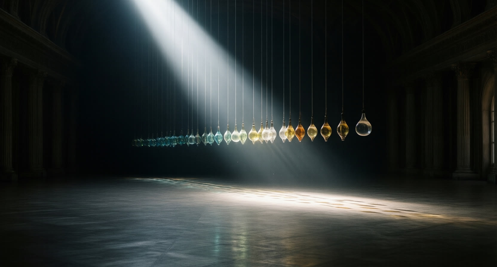

# J-Lens

Status: held.

Can you read the hidden steps of a model's thinking from its middle layers?

AI-generated image (Qwen-Image-2512).

## Why it matters

A 2026 paper, 'Verbalizable Representations Form a Global Workspace in Language Models' (Gurnee et al., arXiv 2607.15495), introduced the Jacobian lens: a way to read a model's middle layers as words. A finding like that is only as strong as its replications on other models. We tried it on a different model, Swift 1.5 27B, a fine-tune of Qwen 3.8 27B, and wrote the pass marks down before each run, so that either outcome would count.

## How we test it

We build the lens, a map from each middle layer of the model to its final answer, from a set of documents.

We score it on six documents it has never seen: how often its top guess is among the text's next tokens, compared with a plain word-frequency guess and with the logit lens, and how far it lands from the model's final answer.

Every pass mark is written down before the run, and a different agent, one that did not run the test, grades it. When a number turns out wrong, the correction stays in the repo beside the claim.

Until Stage 2 we scored the lens on next-word agreement. That was the wrong measure (see What we got wrong). The next test scores hidden steps.

Figure: How we test the J-lens: three readers of the model's middle layers, each scored against the model's own answer. Drawn from the method above.

## Where we are

- 2026-11-03: Built the measuring instrument. Its first two tests were later withdrawn as proof, when we found a bug in our own checker. (CLAIMS.md rows 1.1 to 1.7, 4.2)
- 2026-11-04: First map, from 6 documents. The first pre-registered test failed its bar: in layers 20 to 44 the lens found well under 1 of the next 10 tokens. (CLAIMS.md rows 2.1, 2.2, 2.7)
- 2026-11-05: A random-probe shortcut for building the map failed its bar: its top guess matched the exact map 70%, 60% and 37% of the time at three layers, against a pass mark of 90%. (CLAIMS.md rows 3.1)
- 2026-11-06: Found a bug in our own checker: its answer-key copy of the model had no causal mask, so it could read ahead. The two tests that ran on it were withdrawn as proof. (CLAIMS.md rows 4.1, 4.2)
- 2026-11-07: Map rebuilt from 22 documents. It cleared its pre-written bar against the 6-document map (the score it used was later judged too easy), but in the middle layers it is still worse than the logit lens. (CLAIMS.md rows 5.2 to 5.4)
- 2026-11-10: A blend that is mostly the logit lens with a small dose of the map lands about 8% closer to the model's own final answer on fresh text (reported only; no pass mark was set for it in advance). Reading past the very next token worked for no method. (CLAIMS.md rows 6.1, 6.4, 6.6)
- 2026-11-18: Stage 2: the 54-document map did not read fresh text better than the 22-document map, and failed all three conditions of its pre-written bar (average gain -0.041). No Stage 3 on this design. (CLAIMS.md rows 7.1, 7.2)

## What's next

We will not run a Stage 3 on this design. Next, we ask a different question of the lens we already have, with the test written down before any run.

## What we found so far

### Stage 2: more data did not help (November 2026)

We set the bar before fitting: the lens fitted on 54 documents had to read fresh text measurably better than the one fitted on 22. Three conditions had to hold together: an average gain above zero, a 95% confidence interval entirely above zero, and an average above 0.078, the spread we saw between document samples.

Result: average gain -0.041 (95% CI -0.077 to -0.007). It fails all three conditions. "Not better" is firm. "Worse" is not: grouped by passage, the interval spans zero.

We predicted a gain of 0.25 to 1.30. That prediction was wrong. It came from extending a curve well past the range we had measured.

Both fitted lenses still trail the plain logit lens on these layers, by about 1.5 nats of KL. The paper that introduced the lens reports the same on this measure: it is not built to predict the next token.

We will not run a Stage 3 on this design. Next, we ask a different question of the lens we already have, with the test written down before any run.

### What we got wrong

**We chose the wrong measure.** Before Stage 2 we signed a bar on how closely the lens matches the model's own next-word prediction (KL divergence). The paper that introduced the lens says in its appendix that the lens scores worse than the plain logit lens on that measure through most of the network, and calls this "a feature rather than a defect". That sentence was in the paper before we began. We tested the lens on something it is not built to do.

**We spent on a forecast we had not tested.** The case for Stage 2 rested on a curve fitted to lenses built from up to 22 documents, then stretched to 54: about two and a half times past what we had measured. It predicted a gain of 0.25 to 1.30. The run measured -0.041. Even the curve's best case left our lens behind the plain logit lens. We wrote that down at the time, but not in the first line. Stage 2 used seven nights of GPU time.

The paper also reports that its lens already beats the simpler lenses with as few as 10 prompts, and that more data helps only modestly. More documents was never the lever.

### What we do now

**The paper's own test, on the lens we already have.** The paper's public data includes six sets of prompts, each with a hidden step that is known in advance. For example, "the color of the planet fourth from the Sun is" needs "Mars" before it can answer "red". The question: does our lens surface the hidden step more often than the plain logit lens does? The pass line, and the controls that must fail (a shuffled lens; a same-category decoy word), are published before any run. No new fitting, and no new GPU nights for the fit.

**Two rules we now keep.**

1. The measure must be one the source paper uses for the claim we are testing.
2. A forecast is checked against data it was not fitted to before anything is spent on it.

### Results so far, run by run.
J-Lens. Status: results so far. Not filed in the notebook yet.

At mid-depth, neither the Jacobian nor the logit lens predicts upcoming tokens better than word frequency; only the trained lens beats frequency, and only for the next token.

Next token, top-1, middle layers, 306 held-out positions: word frequency 0.075; logit lens 0.070; Jacobian lens 0.054; shrunk Jacobian lens 0.097 (not distinguishable from frequency); trained lens 0.219. One token further ahead: word frequency 0.073; every lens 0.019 or lower.

The sentence and the row were checked against the result file by a different agent, one that didn't run it. The code, the result files and one row per public claim are in CLAIMS.md: https://github.com/NotYourAverageAutomaton/j-lens/blob/main/CLAIMS.md

Figure: Does our map get better with more documents? Distance from the model's own answer in its middle layers, mean KL over layers 20 to 44 on six check passages, by the number of documents the map is built from. Lower is better. Bars: 1 SD across document subsets (none at 6 and 22). Blend strength was chosen on these same six passages; its never-seen result is on fresh text (not shown). The dotted curves are fits, not data. Source: dose_kl.json 6be964a0; every point is in the data file. Data file: /data/jlens-dose-points.csv

## Evidence

- CLAIMS.md: https://github.com/NotYourAverageAutomaton/j-lens/blob/main/CLAIMS.md
- prereg/: https://github.com/NotYourAverageAutomaton/j-lens/tree/main/prereg
- j-lens repo: https://github.com/NotYourAverageAutomaton/j-lens
- Corrections: /corrections.md

## Built on

Only the papers our method uses. For each: what we took, and what we did differently.

1. Wes Gurnee, Nicholas Sofroniew, Adam Pearce, Mateusz Piotrowski, Isaac Kauvar, Runjin Chen, Anna Soligo, Paul Bogdan, Euan Ong, Rowan Wang, T. Ben Thompson, David Abrahams, Subhash Kantamneni, Emmanuel Ameisen, Joshua Batson, Jack Lindsey. Verbalizable Representations Form a Global Workspace in Language Models. Anthropic, Transformer Circuits, 2026. https://transformer-circuits.pub/2026/workspace
   Took: the Jacobian lens (the average derivative of the final state with respect to a middle layer) and its layer-by-layer signature.
   Different: we built our own implementation from the paper, using the authors' code only as a check. We ran it on a different, larger model and scored it against a plain word-frequency guess.
2. Nora Belrose, Igor Ostrovsky, Lev McKinney, Zach Furman, Logan Smith, Danny Halawi, Stella Biderman, Jacob Steinhardt. Eliciting Latent Predictions from Transformers with the Tuned Lens. arXiv, 2023. https://arxiv.org/abs/2303.08112
   Took: the trained lens, as the strong comparison: the best a lens can do when it is trained for the job.
   Different: trained on our own text and scored on held-out positions against word frequency.
3. Koyena Pal, Jiuding Sun, Andrew Yuan, Byron C. Wallace, David Bau. Future Lens: Anticipating Subsequent Tokens from a Single Hidden State. CoNLL, 2023. https://arxiv.org/abs/2311.04897
   Took: reading tokens further ahead than the next one, and its top-k measure.
   Different: all positions of real text, not only the ones the model gets right, with frequency and shuffled baselines.
4. nostalgebraist. The logit lens. Blog post, 2020.
   Took: reading a middle layer straight through the model's own final output layer, with nothing learned in between.
   Different: we use it only as the simplest baseline; every other lens has to beat it.

Further reading: Hernandez et al., Linearity of Relation Decoding in Transformer Language Models, arXiv, 2023. https://arxiv.org/abs/2308.09124

Text and figures: CC BY-NC-SA 4.0. Commercial use: ask us for terms; contact is not open yet. Full text: /LICENSE
